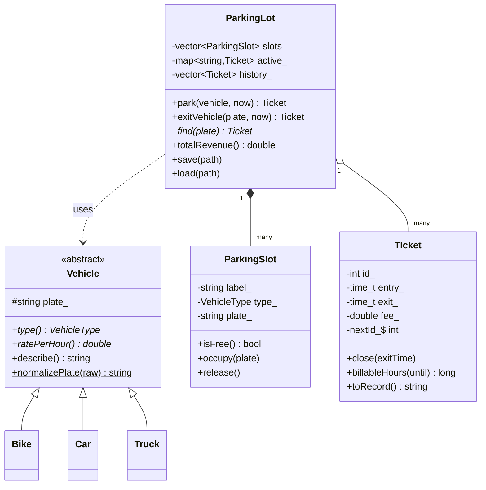

# Parking Management System (C++)


Object Oriented Programming lab project written in **C++17**. A console application that manages a parking lot with separate slots for bikes, cars and trucks, issues tickets, calculates fees and saves its data to a file.

## Features
- Park a vehicle: finds the first free slot of the right type and prints a ticket
- Exit a vehicle: calculates the fee (hours rounded up, minimum 1 hour) and frees the slot
- Live slot status, search by registration number, revenue report
- Registration numbers are validated and normalised (`ka 01-ab 1234` becomes `KA01AB1234`)
- Data is saved to `parking_data.csv` and reloaded on the next run
- Unit tests and a GitHub Actions workflow that builds and tests on every push

| Vehicle | Rate per hour | Default slots |
|---|---|---|
| Bike | Rs 10 | 5 (B1–B5) |
| Car | Rs 20 | 10 (C1–C10) |
| Truck | Rs 40 | 3 (T1–T3) |

## OOP concepts used
| Concept | Where |
|---|---|
| Classes and encapsulation | `ParkingSlot`, `Ticket`, `ParkingLot` keep their data private and expose methods |
| Abstract class and pure virtual functions | `Vehicle::type()` and `Vehicle::ratePerHour()` |
| Inheritance | `Bike`, `Car`, `Truck` derive from `Vehicle` |
| Polymorphism | `ParkingLot::park()` calls `vehicle.ratePerHour()` through a base reference |
| Virtual destructor, smart pointers | `Vehicle`, `std::unique_ptr` in `makeVehicle()` |
| Constructor delegation | private and public `Ticket` constructors |
| Static data member | `Ticket::nextId_` generates ticket numbers |
| Operator overloading | `operator<<` prints a `Ticket` |
| Exception handling | custom `ParkingException` for every rule violation |
| Function template | `readValue<T>()` in `Utils.h` |
| File handling | `ParkingLot::save()` and `load()` (CSV) |
| STL | `vector`, `map`, `algorithm`, `string`, `sstream` |

## Class diagram


## Project structure
```
parking-management-system/
├── include/            header files (Vehicle, ParkingSlot, Ticket, ParkingLot, Utils, Exceptions)
├── src/                implementation files and main.cpp (menu)
├── tests/              test_parking.cpp (assert-based unit tests)
├── .github/workflows/  build.yml (GitHub Actions)
├── Makefile
└── README.md
```

## Build and run
You need a C++17 compiler (g++ or clang++).

**Linux / macOS / Windows with MinGW or WSL (using make):**
```bash
make          # build the program
make run      # build and run
make test     # build and run the unit tests
make clean
```

**Without make (any OS with g++):**
```bash
g++ -std=c++17 -Iinclude src/Vehicle.cpp src/ParkingSlot.cpp src/Ticket.cpp src/ParkingLot.cpp src/main.cpp -o parking
./parking          # on Windows: parking.exe
```

## Sample run
```
===== PARKING MANAGEMENT SYSTEM =====
 1. Park a vehicle
 ...
Choose an option: 1
Vehicle type (1 Bike, 2 Car, 3 Truck): 2
Registration number: ka 01-ab 1234
----------- PARKING TICKET -----------
Ticket no : 1
Vehicle   : Car KA01AB1234
Slot      : C1
Rate      : Rs 20.00 / hour
Entry     : 2026-11-26 03:32
--------------------------------------
```

## Upload to GitHub
1. Create a new empty repository on github.com.
2. In this folder run:
   ```bash
   git init
   git add .
   git commit -m "Parking Management System in C++"
   git branch -M main
   git remote add origin https://github.com/priyanshubhardwaj242-alt/test.i.git
   git push -u origin main
   ```
3. Open the **Actions** tab. The workflow builds the project and runs the tests automatically.

You can also drag the files into the repository using **Add file → Upload files**, but keep the folder structure (`include/`, `src/`, `tests/`, `.github/workflows/`).

## Possible extensions
Multiple floors, hourly rate changes by time of day, monthly pass holders, a Qt or web front end.
